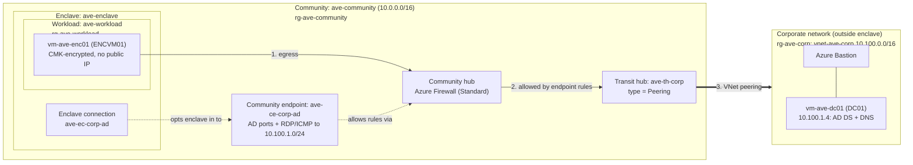

# Architecture 01: Enclave workload to corporate Active Directory (transit hub peering)

A VM inside an Azure Virtual Enclave reaches an Active Directory domain controller in a separate corporate VNet that sits **outside** the enclave. Traffic goes through the community firewall and a **transit hub** that uses VNet peering.

Everything is defined in Bicep and deployed by one PowerShell script.

**Contents:** [Architecture](#architecture) · [Prerequisites](#prerequisites) · [Quick start](#quick-start) · [Stages](#stages) · [Configuration](#configuration) · [Promote the DC](#manual-step-promote-the-dc) · [Validate](#point-the-enclave-vm-at-ad-and-validate) · [Walkthrough](#walkthrough-talk-track) · [Teardown](#teardown) · [Troubleshooting](#troubleshooting) · [Costs](#cost-and-known-caveats)

## Architecture



| Concept | Resource | What it shows |
|---|---|---|
| **Community** | `ave-community` | A shared governance and network boundary (hub, firewall, address space, approval policy) that owns every enclave. |
| **Enclave** | `ave-enclave` | An isolated, policy-governed network carved out of the community. By default, nothing gets in or out. |
| **Workload** | `ave-workload` linked to `rg-ave-workload` | Resource groups linked to the enclave inherit its guardrails, for example customer-managed key (CMK) encryption on VM disks. |
| **Transit hub** | `ave-th-corp` (Peering) | The controlled on-ramp from the community to a network outside it. Here that network is a generic corporate VNet. |
| **Community endpoint** | `ave-ce-corp-ad` | Publishes *what* outside the community can be reached (DC subnet, AD ports) and *through which* transit hub. |
| **Enclave connection** | `ave-ec-corp-ad` | An enclave explicitly opts in to an endpoint. Only then are firewall rules programmed for that enclave. |

## Prerequisites

- An Azure subscription where you are **Owner**, or **Contributor + User Access Administrator**. The templates create role assignments.
- Access to Azure Virtual Enclaves (`Microsoft.Mission`) in your subscription.
- PowerShell 7+ with the Az modules (`Az.Accounts`, `Az.Resources`, `Az.Compute`, `Az.KeyVault`):
  ```powershell
  Install-Module Az -Scope CurrentUser -Repository PSGallery
  ```
- Bicep CLI on `PATH`: `winget install -e --id Microsoft.Bicep`
- Quota in the target region for 2 × `Standard_D2s_v3` (the default; change `vmSize` in `demo.bicepparam`), Azure Firewall, and Bastion.
- If your execution policy blocks the downloaded scripts, unblock them first:
  ```powershell
  Get-ChildItem -Recurse -Filter *.ps1 | Unblock-File
  ```

Prefer Azure CLI? Use `Deploy-AVEDemo.AzCli.ps1`. It takes the same parameters and runs the same stages with `az` commands.

## Quick start

Run these from this folder (`architectures/01-transit-hub-peering-ad`).

```powershell
Connect-AzAccount
.\Deploy-AVEDemo.ps1 -SubscriptionId <subscription-guid>     # prompts for the VM admin password
```

Plan for **1.5–3 hours** end to end. Do a full run ahead of any live demo.

## Stages

| Stage | Template | Scope | Creates | Typical time |
|---|---|---|---|---|
| 1 | `bicep/stage1-foundation.bicep` | subscription | RGs, corporate VNet + NSG, Bastion, DC VM, **community** | 30–60 min |
| 2 | `bicep/stage2-connectivity.bicep` | `rg-ave-community` | **Transit hub** (peering to the corporate VNet), **community endpoint** | 10–30 min |
| 3 | `bicep/stage3-enclave.bicep` | `rg-ave-enclave` | **Enclave**, **workload** (Azure creates `rg-ave-workload`), **enclave connection** | 30–45 min |
| 4 | `bicep/stage4-workload-vm.bicep` | `rg-ave-workload` | Managed identity, Key Vault + key, disk encryption set, **enclave VM** | 10–15 min |
| 5 | `scripts/Test-AdConnectivity.ps1` (run command) | enclave VM | Port, ICMP, and DNS tests from inside the enclave to the DC | 2 min |

Each stage uses a fixed deployment name, so a failed or interrupted run can be resumed:

```powershell
.\Deploy-AVEDemo.ps1 -SubscriptionId <guid> -StartAtStage 3      # re-uses outputs from stages 1-2
.\Deploy-AVEDemo.ps1 -SubscriptionId <guid> -StopAfterStage 2    # stop early
```

## Configuration

**Settings live in one file: `bicep/demo.bicepparam`.** Every `stageN-*.bicepparam` extends it, and the deploy script reads it too. Edit it before deploying.

| Setting (`demo.bicepparam`) | Default | Notes |
|---|---|---|
| `prefix` | `ave` | Prefix for every name (2–8 lowercase alphanumeric characters). |
| `location` | `westus2` | All resources go in this region. |
| `communityAddressSpaces` | `10.0.0.0/16` | Must not overlap the corporate VNet. The script checks this. |
| `corpVnetAddressPrefix` | `10.100.0.0/16` | Identity subnet `10.100.1.0/24`, DC `10.100.1.4`. |
| `firewallSku` | `Standard` | Community firewall SKU. |
| `vmSize` | `Standard_D2s_v3` | Size for both VMs. |
| `adminUsername` | `aveadmin` | Shared by both VMs. |
| `useDcForEnclaveDns` | `false` | Set to `true` after the DC is promoted, then re-run stage 4. |
| `adDomainName` | *(empty)* | Enables the DNS SRV checks in stage 5. |
| `encryptionAtHost`, `keyVaultPublicNetworkAccess` | `false`, `Enabled` | Guardrail knobs, see [caveats](#cost-and-known-caveats). |

Secrets are never stored in files. The script reads them from the prompt or environment variables (`AVE_ADMIN_PASSWORD`, `AVE_ADMIN_PRINCIPAL_ID`).

Script parameters (see `Get-Help .\Deploy-AVEDemo.ps1 -Full`):

| Parameter | Notes |
|---|---|
| `-SubscriptionId` | Target subscription. |
| `-AdminPassword` | Secure string. Falls back to `$env:AVE_ADMIN_PASSWORD`, then prompts. |
| `-DomainName` | AD domain for stage 5 DNS checks. Overrides `adDomainName`. |
| `-StartAtStage` / `-StopAfterStage` | Resume or stop early (1–5). |
| `-AdminPrincipalId` | Object ID that gets Contributor on the community, enclave, and workload. Defaults to the signed-in principal. |
| `-SkipRoleAssignments` | Don't create role assignments. |
| `-SkipVmDeployment` | Skips the DC VM (stage 1), the enclave VM (stage 4), and stage 5. No admin password needed. |
| `-Teardown` / `-Force` | Delete everything, optionally without the confirmation prompt. |

## Manual step: promote the DC

The corporate VM is a plain Windows Server 2022 VM outside the enclave. Promote it by hand.

1. In the portal, open `vm-ave-dc01` and choose **Connect > Bastion**. Sign in as `aveadmin`.
2. Initialize the 32 GB data disk for the AD database:
   ```powershell
   Get-Disk | Where-Object PartitionStyle -eq 'RAW' |
       Initialize-Disk -PartitionStyle GPT -PassThru |
       New-Partition -DriveLetter F -UseMaximumSize |
       Format-Volume -FileSystem NTFS -NewFileSystemLabel 'NTDS' -Confirm:$false
   ```
3. Install AD DS and create the forest. The DC reboots when this finishes.
   ```powershell
   Install-WindowsFeature AD-Domain-Services, DNS -IncludeManagementTools
   Install-ADDSForest -DomainName 'corp.contoso.local' -DomainNetbiosName 'CORP' `
       -DatabasePath 'F:\NTDS' -LogPath 'F:\NTDS' -SysvolPath 'F:\SYSVOL' `
       -InstallDns -SafeModeAdministratorPassword (Read-Host -AsSecureString 'DSRM password') -Force
   ```
4. After the reboot, add a DNS forwarder to Azure DNS and allow ping:
   ```powershell
   Add-DnsServerForwarder -IPAddress 168.63.129.16
   Enable-NetFirewallRule -Name 'FPS-ICMP4-ERQ-In'
   ```
   The AD DS role opens the AD ports in Windows Firewall automatically. The NSG on `snet-identity` already allows AD ports, RDP, and ICMP from the community address space.

## Point the enclave VM at AD and validate

1. In `bicep/demo.bicepparam`, set `useDcForEnclaveDns = true` and `adDomainName = 'corp.contoso.local'`.
2. Re-run stage 4, which also runs the stage 5 tests:
   ```powershell
   .\Deploy-AVEDemo.ps1 -SubscriptionId <guid> -StartAtStage 4
   ```

The test output should end with:

```
RESULT: Enclave VM can reach Active Directory services in the peered corporate VNet.
```

Then domain-join the enclave VM. Connect through **Bastion** to `vm-ave-enc01` (the enclave deploys its own Bastion when `enclaveBastionEnabled` is `true`).

```powershell
ipconfig /renew; ipconfig /flushdns     # pick up the DC as DNS if it hasn't already
Resolve-DnsName _ldap._tcp.dc._msdcs.corp.contoso.local -Type SRV
Add-Computer -DomainName corp.contoso.local -Credential CORP\aveadmin -Restart
```

## Walkthrough (talk track)

1. **Community = the governance boundary.** One community owns the address space, hub firewall, and approval policy. Every enclave inherits from it, so nobody hand-builds hubs or firewall rules.
2. **Enclave = isolation by default.** Show `ave-enclave`: its VNet, the managed resource group, and the policy assignments. Before the enclave connection exists, the enclave VM can't reach anything outside it.
3. **Workload = guardrails apply automatically.** `rg-ave-workload` was created *by the enclave*. Show the policy that required CMK on the VM disk (the disk encryption set in stage 4).
4. **Transit hub = the controlled door to legacy or corporate networks.** `ave-th-corp` is a VNet peering to `vnet-ave-corp`, a normal VNet that isn't part of the enclave. In production this is where ExpressRoute or VPN connectivity attaches.
5. **Community endpoint + enclave connection = least-privilege access.** The endpoint publishes only the AD ports to only the DC subnet. The enclave must explicitly connect to it, and connections can require approval (`NotRequired` in this sample).
6. **Proof.** Run stage 5 or `Test-AdConnectivity.ps1`: LDAP, Kerberos, and DNS reach the DC through the firewall. Then domain-join the enclave VM.
7. **Optional negative test.** Delete the enclave connection (`ave-ec-corp-ad`) and re-run the test. The path closes, which shows that access is governed centrally and not by NSGs.

## Folder layout

```
Deploy-AVEDemo.ps1                 # deploy / resume / teardown (Az PowerShell modules)
Deploy-AVEDemo.AzCli.ps1           # same, using Azure CLI (az) commands instead
scripts/Test-AdConnectivity.ps1    # runs inside the enclave VM
bicep/
  demo.bicepparam                  # the one settings file to edit
  stage1-foundation.bicep          # subscription scope
  stage2-connectivity.bicep
  stage3-enclave.bicep
  stage4-workload-vm.bicep
  stage*.bicepparam                # each extends demo.bicepparam
  modules/
    naming.bicep                   # shared naming convention (exported function)
    community.bicep  transitHub.bicep  communityEndpoint.bicep
    enclave.bicep  workload.bicep  enclaveConnection.bicep
    corpNetwork.bicep  bastion.bicep  adVm.bicep
    cmkDependencies.bicep  enclaveVm.bicep
```

All Azure Virtual Enclaves resources use `Microsoft.Mission@2026-04-01`.

## Teardown

```powershell
.\Deploy-AVEDemo.ps1 -SubscriptionId <guid> -Teardown           # asks you to type the prefix to confirm
.\Deploy-AVEDemo.ps1 -SubscriptionId <guid> -Teardown -Force    # no prompt
```

Resources are removed in dependency order: workload RG → enclave connection → workload → enclave → community endpoint → transit hub → community → remaining RGs. The CMK Key Vault has purge protection, so it stays soft-deleted for 7 days. If you redeploy during that window, the script recovers it automatically.

## Troubleshooting

### Stage 1 fails: `SubscriptionNotRegisteredForFeature` (`AllowBringYourOwnPublicIpAddress`)

The `corp-bastion` deployment fails with:

```
Subscription /subscriptions/<subscription-id>/... is not registered for feature
Microsoft.Network/AllowBringYourOwnPublicIpAddress required to carry out the requested operation.
```

Register the feature on the subscription, then refresh the provider:

```bash
az account set --subscription <subscription-id>
az feature register --namespace Microsoft.Network --name AllowBringYourOwnPublicIpAddress

# Check status (wait until "Registered")
az feature show --namespace Microsoft.Network --name AllowBringYourOwnPublicIpAddress --query properties.state -o tsv

# Propagate the change
az provider register --namespace Microsoft.Network
```

Notes:
- Registration can take several minutes. Re-run the `show` command until it returns `Registered`, then redeploy with `-StartAtStage 1`.
- You need Contributor or Owner on the subscription to register features.
- If the state stays `Pending`, the feature may need approval through a Microsoft support request.
- The empty resource group in the error path (`resourceGroups//`) is cosmetic. The deployment runs in `rg-ave-corp`.
- Alternatively, let the Bastion template create a new public IP instead of using an existing one.

## Cost and known caveats

- **Cost drivers:** the community's Azure Firewall and hub, two Bastion hosts (corporate and enclave), and two VMs. Tear down when you finish.
- **Enclave guardrails** may deny VM settings beyond CMK, depending on the policy baseline in your tenant. If stage 4 fails with `RequestDisallowedByPolicy`, check the policy name in the error. Common adjustments in `demo.bicepparam`: `encryptionAtHost = true` (register the `Microsoft.Compute/EncryptionAtHost` feature first) or `keyVaultPublicNetworkAccess = 'Disabled'`. Re-run with `-StartAtStage 4` afterwards.
- **Workload RG:** don't create `rg-ave-workload` yourself. Azure Virtual Enclaves creates it and applies deny assignments. Stage 4 waits for it.
- **Transit hub approval:** approvals are `NotRequired` everywhere. If the hub still lands in `PendingApproval`, stage 2 sends the approval PATCH automatically.
- **Enum values** (`networkSize`, `firewallSku`, `approvalPolicy`, endpoint `protocols`) come from the 2026-04-01 REST examples. Bicep doesn't validate them locally, so a typo only surfaces at deploy time.
